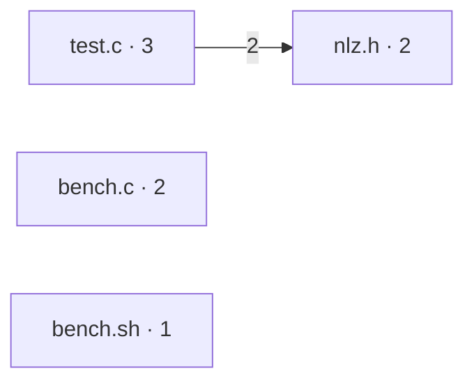
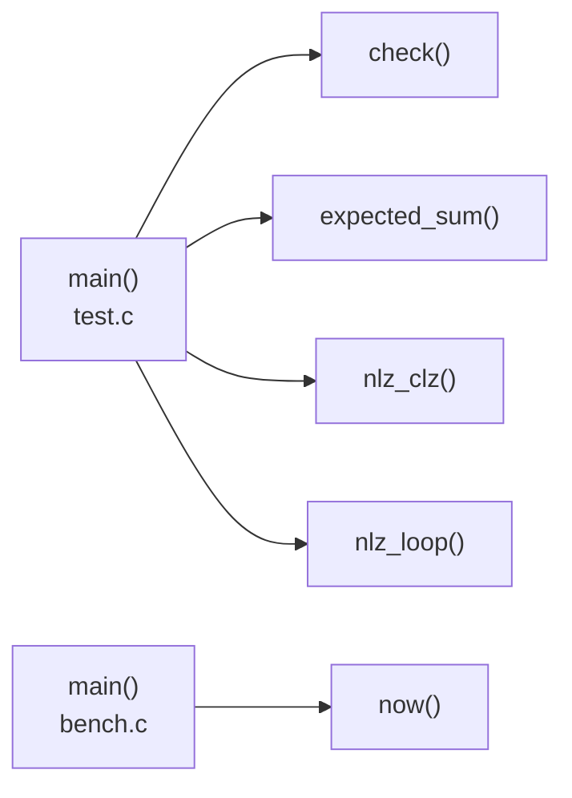

# Codemap: nlz3000

← [README](README.md)

> Generated from commit `8a3b6bb` by `scripts/codemap.py`. Regenerate it from the workspace root with `python3 scripts/codemap.py nlz3000`; don't edit it by hand.

## Files

Each box is a source file and its function count; an arrow means calls into that file.

## Hubs

The most connected functions: where a change reaches furthest.

| Function | Where | Called by | Calls |
|---|---|---|---|
| `main()` | `test.c:37` | 0 | 4 |
| `check()` | `test.c:10` | 1 | 0 |
| `expected_sum()` | `test.c:20` | 1 | 0 |
| `main()` | `bench.c:31` | 0 | 1 |
| `nlz_clz()` | `nlz.h:27` | 1 | 0 |
| `nlz_loop()` | `nlz.h:12` | 1 | 0 |
| `now()` | `bench.c:24` | 1 | 0 |

## Functions

### `bench.c`

- `now()` L24
- `main()` L31 → `now()`

### `bench.sh`

- `temps()` L10

### `nlz.h`

- `nlz_loop()` L12
- `nlz_clz()` L27

### `test.c`

- `check()` L10
- `expected_sum()` L20
- `main()` L37 → `check()`, `expected_sum()`, `nlz_clz()`, `nlz_loop()`
