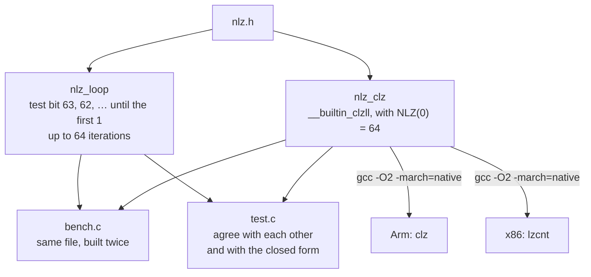

# NLZ3000

> Counting the leading zeros of 64-bit numbers in C: a bit-by-bit loop against one count-leading-zeros instruction, on Arm and x86.


## Overview

`bench.c` adds up NLZ(i) for every i from 0 to N, the number of 0 bits above the highest 1 bit. Built one way it counts bit by bit; built with `-DUSE_CLZ` it uses the CPU's count-leading-zeros instruction. Both print the same sum, and `test.c` checks that sum against a closed form, so it can be trusted without trusting either implementation.

## The Two Versions



`__builtin_clzll(0)` is undefined in gcc, so `nlz_clz` returns 64 for 0 itself. CLZ and LZCNT both return 64 for 0 already, so the check costs nothing in the generated code.

## The Closed Form

The 2^k numbers from 2^k to 2^(k+1) − 1 all have their highest 1 at bit k, so each has NLZ = 63 − k. Summing over k, for N = 2^m − 1:

```text
sum = 64 + Σ (k = 0 .. m−1) 2^k · (63 − k)  =  (65 − m) · 2^m − 1
```

With the default N = 2^30 − 1 that is **37,580,963,839**. `test.c` checks the formula against brute-force sums up to 2^20, and both versions against each other on edge cases and a million random values. Build with `-DN=1000000000u` to sum 0 to 10^9 instead, which gives 35,073,741,857.

## Results

Raspberry Pi 4B (Cortex-A72, 1.8 GHz, Arm A64), gcc 12.2.0, default N, three runs each, with background services running:

| | Run 1 | Run 2 | Run 3 | Median |
|---|---|---|---|---|
| **`nlz_loop`** | 62.1762 s | 61.6088 s | 62.5806 s | 62.1762 s |
| **`nlz_clz`** | 1.2941 s | 1.2399 s | 1.3940 s | 1.2941 s |

**Speedup: 48.0× (medians).** At 1.8 GHz, 62 s over about 37.6 billion loop iterations is roughly 3 clock cycles per bit tested; the instruction handles a whole number in about 2.

On x86 the speedup is smaller. Newer gcc versions can vectorise the bit-by-bit loop with AVX2 under `-march=native`, so the software version starts out partly parallel. Raw seconds between machines aren't comparable (different clocks, cores and compilers); the speedup is, because each machine is measured against itself.

## Build

```bash
gcc -O2 -march=native bench.c -o nlz_loop
gcc -O2 -march=native -DUSE_CLZ bench.c -o nlz_clz
gcc -O2 -march=native test.c -o nlz_test
./nlz_test && ./nlz_loop && ./nlz_clz
```

Check that the instruction is used:

```bash
gcc -O2 -march=native -DUSE_CLZ -S bench.c
grep -n clz bench.s      # Arm
grep -n lzcnt bench.s    # x86
```

On x86, `-march=native` is what enables LZCNT; without it gcc falls back to the older BSR. On Arm, CLZ is in the base instruction set.

**Codemap:** [CODEMAP.md](CODEMAP.md), the files, hub functions and call graph, generated from the code.

---
*powered by logic, coffee, and many sleepless nights*
