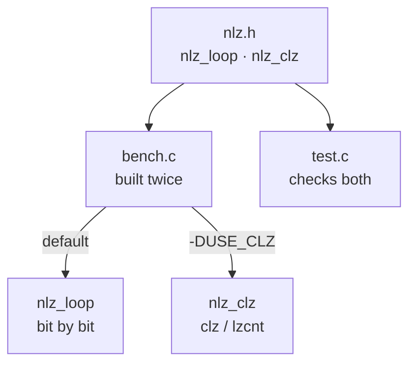

# NLZ3000

> Counting the leading zeros of 64-bit numbers in C: a bit-by-bit loop against one count-leading-zeros instruction, on Arm and x86.


## Overview

`bench.c` adds up NLZ(i) for every i from 0 to N, the number of 0 bits above the highest 1 bit. Built one way it counts bit by bit; built with `-DUSE_CLZ` it uses the CPU's count-leading-zeros instruction. Both print the same sum, and `test.c` checks that sum against a closed form, so it can be trusted without trusting either implementation.

## The Two Versions



`__builtin_clzll(0)` is undefined in gcc, so `nlz_clz` returns 64 for 0 itself. CLZ and LZCNT both return 64 for 0 already, so the check costs nothing in the generated code.

## The Closed Form

The 2^k numbers from 2^k to 2^(k+1) − 1 all have their highest 1 at bit k, so each has NLZ = 63 − k. Summing over k, for N = 2^m − 1:

```text
sum = 64 + Σ (k = 0 .. m−1) 2^k · (63 − k)  =  (65 − m) · 2^m − 1
```

With the default N = 2^30 − 1 that is **37,580,963,839**. `test.c` checks the formula against brute-force sums up to 2^20, and both versions against each other on edge cases and a million random values. Build with `-DN=1000000000u` to sum 0 to 10^9 instead, which gives 35,073,741,857.

## Build and Prove

```bash
./prove.sh
```

It builds `nlz_loop`, `nlz_clz` and `nlz_test` with `gcc -O2 -march=native`, runs the tests, writes the assembly of both builds, and shows that the instruction is in `nlz_clz.s` and absent from `nlz_loop.s`. On x86 it also counts AVX2 registers in `nlz_loop.s`, which shows whether gcc vectorised the loop. The output is saved to `prove_<arch>.txt`.

On x86, `-march=native` is what enables LZCNT; without it gcc falls back to the older BSR. On Arm, CLZ is in the base instruction set.

## Measuring

```bash
./bench.sh
```

Each program runs 4 times on an idle machine, then once while every hardware thread is kept busy with `yes > /dev/null`. The script logs the CPU temperature (and throttling, on a Pi) before each run, then prints arithmetic and geometric means and both speedups. Everything goes to `results_<arch>.txt`. Stop every other program and service before the idle runs, or the numbers aren't idle.

Raw seconds between machines aren't comparable: clocks, cores and compilers all differ. The speedup is, because each machine is measured against itself.

## Results

Measured with the same method as `bench.sh` (4 idle runs with every other program and service stopped, then 1 run with one `yes > /dev/null` per hardware thread), using the earlier version of this harness: N = 10^9, `gcc -O2 -march=native`. Every run printed the correct sum, 35,073,741,857. To repeat them with this code, build with `-DN=1000000000u`.

| | Raspberry Pi 4B | Ryzen 3 3100 |
|---|---|---|
| **ISA** | Arm A64 (RISC) | x86-64 (CISC) |
| **CPU** | Cortex-A72, 4 cores, 1.8 GHz | Zen 2, 4 cores / 8 threads, up to 3.9 GHz |
| **Compiler** | gcc 12.2.0 | gcc 16.2.1 |
| **Instruction** | `clz` | `lzcnt` |
| **Speedup (arithmetic / geometric)** | **47.99× / 48.00×** | **19.91× / 20.34×** |

**Raspberry Pi 4B**, seconds:

| Run | System | Loop | Instruction |
|---|---|---|---|
| 1 | Idle | 53.8217 | 1.1217 |
| 2 | Idle | 53.7954 | 1.1186 |
| 3 | Idle | 53.7994 | 1.1217 |
| 4 | Idle | 53.9093 | 1.1180 |
| 5 | Loaded | 71.4634 | 1.4965 |
| | **Arithmetic mean** | 57.3578 | 1.1953 |
| | **Geometric mean** | 56.9699 | 1.1868 |

**Ryzen 3 3100**, seconds:

| Run | System | Loop | Instruction |
|---|---|---|---|
| 1 | Idle | 5.5835 | 0.2609 |
| 2 | Idle | 5.6487 | 0.2592 |
| 3 | Idle | 5.6439 | 0.2709 |
| 4 | Idle | 5.5841 | 0.2752 |
| 5 | Loaded | 9.5081 | 0.5391 |
| | **Arithmetic mean** | 6.3937 | 0.3211 |
| | **Geometric mean** | 6.2387 | 0.3068 |

### Findings

- **The Ryzen's smaller speedup is the compiler, not RISC vs CISC.** With `-march=native`, gcc 16 vectorised the slow loop with AVX2 (14 `ymm` register uses in its assembly), so it tested 8 bits per pass and started out partly parallel. gcc 12 left the Pi's loop as a plain bit-by-bit loop. Even against the vectorised loop, one instruction was 20× faster.
- **The Pi's numbers match the code.** 53.83 s at 1.8 GHz for 35.07 billion loop iterations is about 2.8 cycles per iteration, close to the two branches each iteration executes. The instruction version needs about 2 cycles per number.
- **The arithmetic mean is the one the loaded run moves more.** One large value adds straight into a sum, while the fifth root of a product damps it:

  | Machine | Program | Loaded vs idle average | Arithmetic mean rose | Geometric mean rose |
  |---|---|---|---|---|
  | Pi | Loop | 1.33× slower | 6.55% | 5.83% |
  | Pi | Instruction | 1.34× slower | 6.72% | 5.97% |
  | Ryzen | Loop | 1.69× slower | 13.87% | 11.11% |
  | Ryzen | Instruction | 2.02× slower | 20.45% | 15.13% |

- **Load hit the two machines differently.** On the Pi, both programs slowed by the same factor, so the speedup barely moved (idle-only: 48.06×). The Cortex-A72 runs one thread per core, so 5 threads on 4 cores each lost about the same share. On the Ryzen, the load hurt the fast program more (idle-only speedup: 21.07×). With two threads per core (SMT), a `yes` on the same core competes for execution units, and a quarter-second run feels a few interruptions far more than a 5.6-second one.
- **Heat didn't change the results.** The Ryzen went from 58 °C to 75 °C and the Pi from 60 °C to 72 °C, with steady times. The Pi reported `throttled=0xf0000` before every run: the low bits were 0, so it was not throttling during the runs; the high bits only record that it had throttled at some point since boot.

**Codemap:** [CODEMAP.md](CODEMAP.md), the files, hub functions and call graph, generated from the code.

---
*powered by logic, coffee, and many sleepless nights*
