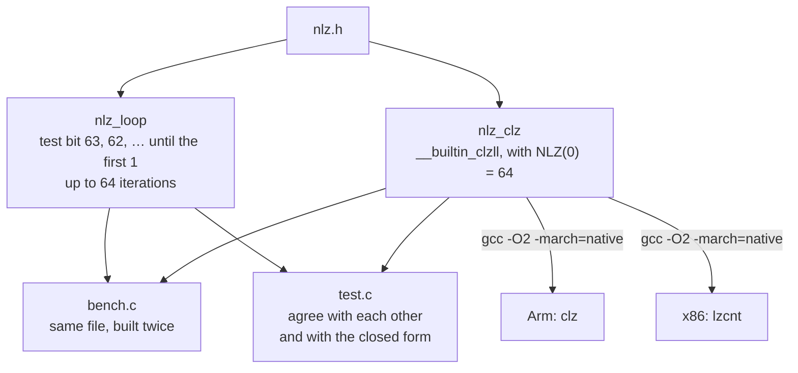

# NLZ3000

> Counting the leading zeros of 64-bit numbers in C: a bit-by-bit loop against one count-leading-zeros instruction, on Arm and x86.


## Overview

`bench.c` adds up NLZ(i) for every i from 0 to N, the number of 0 bits above the highest 1 bit. Built one way it counts bit by bit; built with `-DUSE_CLZ` it uses the CPU's count-leading-zeros instruction. Both print the same sum, and `test.c` checks that sum against a closed form, so it can be trusted without trusting either implementation.

## The Two Versions



`__builtin_clzll(0)` is undefined in gcc, so `nlz_clz` returns 64 for 0 itself. CLZ and LZCNT both return 64 for 0 already, so the check costs nothing in the generated code.

## The Closed Form

The 2^k numbers from 2^k to 2^(k+1) − 1 all have their highest 1 at bit k, so each has NLZ = 63 − k. Summing over k, for N = 2^m − 1:

```text
sum = 64 + Σ (k = 0 .. m−1) 2^k · (63 − k)  =  (65 − m) · 2^m − 1
```

With the default N = 2^30 − 1 that is **37,580,963,839**. `test.c` checks the formula against brute-force sums up to 2^20, and both versions against each other on edge cases and a million random values. Build with `-DN=1000000000u` to sum 0 to 10^9 instead, which gives 35,073,741,857.

## Build and Prove

```bash
./prove.sh
```

It builds `nlz_loop`, `nlz_clz` and `nlz_test` with `gcc -O2 -march=native`, runs the tests, writes the assembly of both builds, and shows that the instruction is in `nlz_clz.s` and absent from `nlz_loop.s`. On x86 it also counts AVX2 registers in `nlz_loop.s`, which shows whether gcc vectorised the loop. The output is saved to `prove_<arch>.txt`.

On x86, `-march=native` is what enables LZCNT; without it gcc falls back to the older BSR. On Arm, CLZ is in the base instruction set.

## Measuring

```bash
./bench.sh
```

Each program runs 4 times on an idle machine, then once while every hardware thread is kept busy with `yes > /dev/null`. The script logs the CPU temperature (and throttling, on a Pi) before each run, then prints arithmetic and geometric means and both speedups. Everything goes to `results_<arch>.txt`. Stop every other program and service before the idle runs, or the numbers aren't idle.

Raw seconds between machines aren't comparable: clocks, cores and compilers all differ. The speedup is, because each machine is measured against itself.

**Codemap:** [CODEMAP.md](CODEMAP.md), the files, hub functions and call graph, generated from the code.

---
*powered by logic, coffee, and many sleepless nights*
